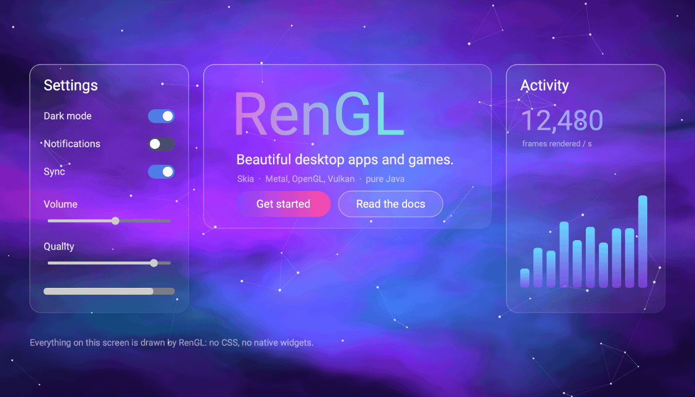
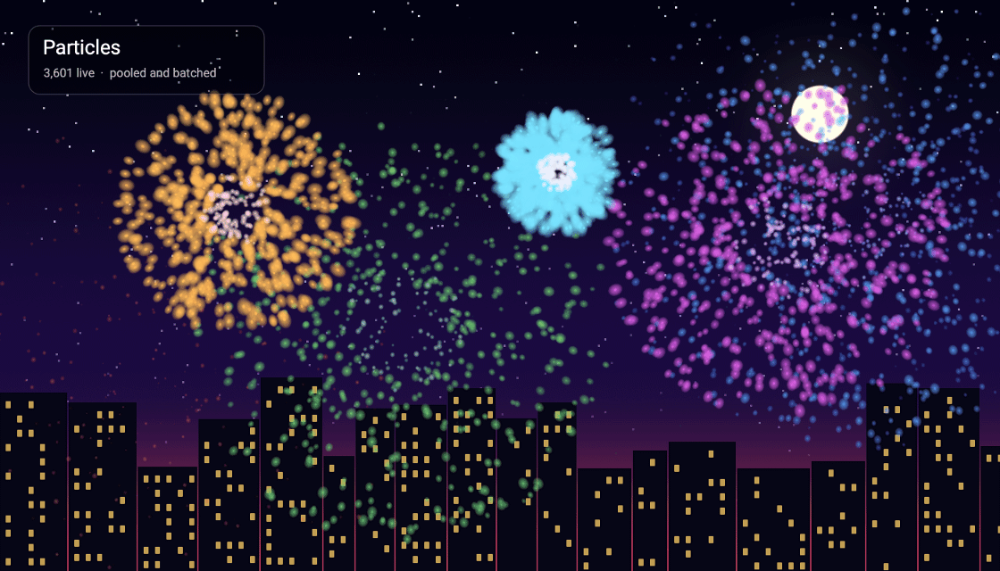
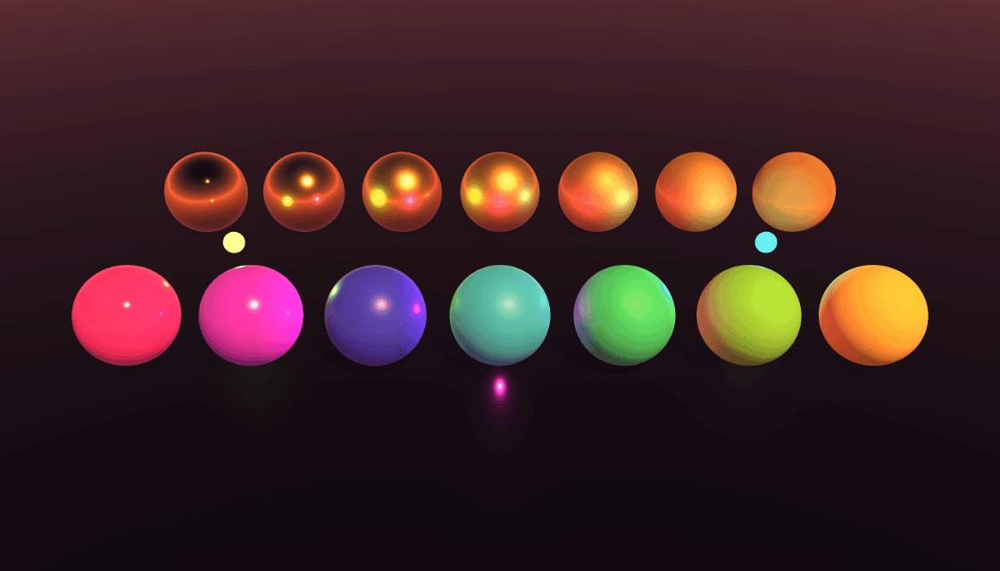

# RenGL

RenGL is a Java toolkit for building desktop apps and 2D games with a UI that looks like you designed it.
It opens a window with GLFW and draws everything with Skia (through Skiko): Metal on macOS, OpenGL on Windows and Linux,
and Vulkan if you ask for it. Widgets are drawn by RenGL itself rather than wrapped from a native widget set, and there
is no CSS engine. Everything is styled from Java.

It started as a rewrite of my JavaFX toolkit, RenEngine, and grew into more than that: a widget library, a 2D game
framework, audio and video playback, and an optional 3D layer with physically based rendering, a physics engine, DLSS
and FSR upscaling and frame generation, and ray and path tracing.

**Mission**: RenGL brings creativity and design to everyday applications. Boring, simplistic designs don't have to be
the normal.

<p align="center">
  
</p>

## See it move

**Styled from Java.** Everything above is RenGL: a custom SkSL shader as the background, translucent panels with gradient
borders, gradient text, and the stock widgets.

**A 2D game toolkit.** Thousands of pooled, batched particles, a shader-drawn sky and a scrolling city, all in a plain
window with no game engine on top.

<p align="center">
  
</p>

**Optional 3D.** Physically based materials, image-based sky lighting, shadows, fog and thousands of dynamic lights,
rendered with Vulkan or OpenGL and shown inside the same UI, behind it, or on a screen in the world. It can also trace
shadows, reflections, global illumination and whole paths of light (in hardware on a Vulkan GPU with ray queries, in shader
code elsewhere, a Mac included), upscaled with DLSS, FSR or MetalFX. Programs that don't use it never pay for it.
[More below](#the-3d-layer).

<p align="center">
  
</p>

```java
public class Hello {
    static void main() {
        Window window = new Window(new WindowOptions("Hello RenGL").setDimensions(1280, 720));

        Container root = new Container(1280, 720);
        window.addContainer(root);

        TextOverlay title = new TextOverlay("Hello, RenGL!", 48f, Color.BLACK);
        title.setPosition(50, 50);
        root.addElement(title);

        new Engine().start(window); // blocks until the window closes
    }
}
```

## What's in it

| | |
|---|---|
| **UI toolkit** | Text, text fields and areas, a rich text editor with offline spell checking, buttons, sliders, dropdowns, color and date pickers, trees, sortable and editable tables, list boxes, accordions, tool and status bars, toasts and message boxes, tabs, menus, tooltips, modals, scroll and split containers, and more. [Every widget](docs/overlays/README.md) has its own page. |
| **Game widgets** | Knobs, gauges, a virtual joystick, a minimap, hotkey capture, an inventory grid, a developer console and a radial menu. |
| **Charts** | Line, bar, scatter, bubble, pie and donut [charts](docs/charts/README.md) drawn by the engine: live data that eases into place, log and time axes, tooltips, a legend that hides series, and the theme's colors. |
| **Layouts** | Vertical, horizontal, grid, stack, flow and dock layouts, with relative sizing and weights. A screen can also be loaded from JSON. |
| **Resizable and draggable containers** | Containers that follow the window, scale their contents and fonts, and can be dragged or resized by the user. |
| **Styling** | Backgrounds, borders, gradients, animated paints, themes, custom fonts, SVG icons, and animated backgrounds behind elements. |
| **Animation** | Transitions, tweens and sequences. |
| **2D game framework** | Scenes and transitions, entities and components loaded from scene files, a fixed-step game loop, cameras, sprites and atlases, Tiled tile maps, sprite animation, particles, SkSL shaders and post effects, geometry and raycasts, spatial grids, pools, event bus and debug drawing. |
| **Audio** | OpenAL playback of Ogg Vorbis, Opus, FLAC, MP3 and WAV, with channels, fades, streamed music and 3D positioned sound. |
| **Video** | Streamed playback of large files with synced sound. |
| **3D (optional)** | PBR materials, cascaded, spot and point shadows, HDR sky lighting, glTF/OBJ/FBX models, skeletal animation and blend shapes, instancing, a built-in physics engine, upscaling and frame generation, and ray and path tracing, shown in a viewport, behind the whole UI or on a screen in the world. [Details below.](#the-3d-layer) |
| **App plumbing** | Multiple windows, file dialogs, a scheduler, background loading, downloads, config files, an input action map with rebinding for keyboard, mouse and gamepads, an asset manager, and a [packager](docs/reference/packaging.md) that builds Windows, macOS and Linux apps (with a Windows setup.exe or Linux .deb) from one machine. |

## The 3D layer

An optional layer (`rengl-3d`) renders into an offscreen picture with Vulkan or OpenGL, and the UI draws that picture like
an image. The same GLSL source and the same scene code run on both APIs. Nothing starts until a program asks for 3D.

| | |
|---|---|
| **Rendering** | A forward renderer with classic and physically based materials (normal, metallic-roughness, occlusion and emissive maps), mipmapped and anisotropic textures, alpha blending, 4x anti-aliasing, frustum and [occlusion culling](docs/3d/scenes.md#occlusion-culling), and [instancing](docs/3d/instancing.md) for thousands of copies in one draw. |
| **Lighting** | Directional, spot and point lights with [shadows](docs/3d/lighting.md#shadows) (cascades for the sun, six faces for points, pluggable filters), sky lighting and reflections from gradient, cube and HDR skies, fog, tone mapping, bloom, ambient occlusion and a colour grade. [Up to about 2000 lights](docs/3d/lighting.md#many-lights) at once through a clustered grid, and [surfaces that glow](docs/3d/lighting.md#glowing-surfaces) onto their surroundings. |
| **Models and animation** | glTF, GLB, OBJ, FBX and Collada, loadable on a background thread. Skeletal animation, blend shapes, and clips that blend, [blinking and flickering lights](docs/3d/lighting.md#blinking-lights). |
| **Physics** | A [pure-Java engine](docs/3d/physics.md): rigid bodies, box, sphere, capsule, convex hull and triangle-mesh colliders, friction and bounce, stacking, sleeping, continuous collision for fast bodies, joints (hinge, slider, rope, spring, ball with cone limits), raycasts, triggers and a character controller. |
| **Interfaces in the world** | A [`UiScreen`](docs/3d/scenes.md#an-interface-on-a-screen) puts a regular RenGL container on a surface in the scene, and the mouse and keyboard work on it through the picking ray: sliders, dropdowns, text fields, popups. |
| **Scene files** | A scene built in the RenGL Editor is saved as [JSON](docs/3d/scene-files.md), with its bodies, colliders, prefabs and terrain, and loaded by the game into a real running scene. |
| **[Upscaling](docs/3d/upscaling.md)** | Draw the scene at a fraction of its size and enlarge it. A built-in temporal upscaler works on every GPU. **AMD FSR 3** and **NVIDIA DLSS** super resolution (Windows) and **Apple MetalFX** (Mac) come from the separate `rengl-upscale` module. |
| **[Frame generation](docs/3d/upscaling.md#dlss-frame-generation)** | **DLSS frame generation** (through NVIDIA Streamline) and **FSR frame generation**, which take over the window's swapchain to present generated frames between the drawn ones. |
| **[Ray tracing](docs/3d/ray-tracing.md)** | On Vulkan GPUs with ray queries (NVIDIA RTX, AMD RDNA 2 and later, Intel Arc): exact shadows, reflections of the objects around a surface, ambient occlusion, one-bounce global illumination and full path tracing, each a single call. **DLSS Ray Reconstruction** denoises the paths where there is an RTX GPU, and the engine's own filter does elsewhere. A GPU without ray queries (a Mac, say) traces the same rays in shader code, slower. |

```java
scene.setRenderScale(0.5f);                    // draw a quarter of the pixels...
scene.setUpscaler(new DlssProvider());         // ...and let DLSS rebuild the rest (Upscalers.builtIn() needs no library)
scene.setPathTracing(true);                    // light that bounces around the room
scene.setPathTracingBounces(4);
scene.setRayReconstruction(true);              // DLSS cleans up the noise (on by default)
```

FSR and DLSS are bindings, not copies. `rengl-upscale` carries none of AMD's or NVIDIA's code, is left out of the
`RenGL` jar, and finds their libraries at run time, which you download from the vendors yourself (they are Windows-only).
See [Upscaling](docs/3d/upscaling.md) for where to get them and how to point at them. Without them the provider says it is
unavailable, nothing starts, and the built-in upscaler is still there. On a Mac, `MetalFxProvider` needs nothing: MetalFX is part
of macOS.

What has and hasn't been run: FSR 3, DLSS, both frame generations and Ray Reconstruction have run on a Windows machine
with an NVIDIA RTX 4090. FSR 4 is requested on the AMD GPUs that offer it but has never run on one, MetalFX was written without
a Mac to try it on, Intel XeSS is not supported, and ray tracing has only been checked on NVIDIA.

## Modules

RenGL is split into Maven modules, so a project depends on what it uses. `rengl-core` is the window, UI toolkit, input
and 2D game framework; audio, video, web views (WebView2 on Windows; an installed Chrome, Edge or Chromium elsewhere; WKWebView and WebKitGTK written, opt-in, never run), Vulkan, 3D, spell checking, tile maps, entities, charts, downloads and UI files are
separate artifacts, and so are the vendor upscalers (`rengl-upscale`), which carry no vendor code and are kept out of the
all-in-one jar for licensing reasons. `io.github.piitex:RenGL` pulls in all the others, as the single jar did before. See
[Modules](docs/modules.md) for what each brings and which to pick.

```xml
<dependency>
    <groupId>io.github.piitex</groupId>
    <artifactId>rengl-core</artifactId>
    <version>0.1.0</version>
</dependency>
```

## Requirements

- **JDK 25**
- **Maven** (a wrapper is included: `./mvnw`)
- A GPU that supports **Metal** (macOS) or **OpenGL 3.3** (Windows, Linux). Vulkan 1.1 is an optional alternative.
- For the 3D layer on macOS, Vulkan (through MoltenVK), since Metal can't share its GPU with it. Ray tracing is hardware
  on a Vulkan GPU with ray queries and shader code on any Vulkan 1.2 GPU; DLSS needs a GeForce RTX card.

Native libraries (LWJGL and Skiko) are selected automatically for Windows, Linux and macOS on x86-64 and arm64, and each module brings only its own. A project of your own picks them with one Maven profile per platform: see [Setting up a Maven project](docs/getting-started.md#setting-up-a-maven-project).

## Building and running

```bash
./mvnw compile
```

Run any class that calls `Engine.start`. On macOS the JVM needs `-XstartOnFirstThread`, since windowing has to happen on
the first thread:

```text
-XstartOnFirstThread --enable-native-access=ALL-UNNAMED
```

The [demos](rengl-examples/src/main/java/me/piitex/examples/demo) (in the `rengl-examples` module; run them with the repository root as the working directory, except `EntityDemo`, which expects `rengl-examples`) are the quickest way to see what it can do. Start with `Demo`, then try
`FireworksDemo`, `Studio3DDemo`, `GameLoopDemo`, `SpriteDemo`, `ResizableContainerDemo` or `VideoDemo`. For the 3D layer:

| Demo | Shows |
|---|---|
| `Studio3DDemo`, `Scene3DDemo`, `HdrSkyDemo` | PBR materials under a sunset or an HDR sky, shadows, a loaded model, orbiting lights |
| `LightsDemo` | A night city with up to 1500 coloured lights, glowing lamps and occlusion culling |
| `WorldScreenDemo` | A working control panel on a screen in the world |
| `PhysicsDemo`, `PlaygroundDemo`, `TerrainDemo`, `DominoDemo`, `FastBodiesDemo` | Stacks, joints, a character controller, terrain, and bodies fired at a thin wall |
| `UpscalingDemo` | Render scale, the built-in, FSR and DLSS upscalers, and frame generation, with frames drawn against frames shown |
| `RayTracingDemo` | A room you can switch from rasterized to ray traced shadows, reflections, global illumination and path tracing, with DLSS Ray Reconstruction |

The upscaling and ray tracing demos need Vulkan, and the vendor libraries pointed at with `-Drengl.dlss.dir` and
`-Drengl.fsr.dir`; the [upscaling](docs/3d/upscaling.md#the-demo) and [ray tracing](docs/3d/ray-tracing.md#the-demo) pages
list the launch options.

## Documentation

Everything is documented in [docs](docs/README.md), one page per class or feature, with runnable snippets.

- [Getting started](docs/getting-started.md): your first window
- [Architecture](docs/architecture.md): threads, the frame loop, coordinates and how events reach elements
- [Known limitations](docs/reference/known-limitations.md): what isn't done yet

## The shape of the API

```text
Engine ──drives──▶ Window ──holds──▶ Container ──holds──▶ Element / Overlay
                                        ▲
                       Layout, ScrollContainer, SplitContainer and
                       ModalContainer are all just Containers
```

- `Window` is an OS window. `WindowOptions` holds its settings and stays live: calling `setWidth`, `setTitle`,
  `setFullscreen`, `setMaximized` or even `setRenderer` on a running window changes the window.
- Every window holds `Container`s, and a container holds elements. A layout is just a container that positions its
  children.
- Widgets are `Overlay`s, a kind of `Element`. Write your own by subclassing either.
- Callbacks run on the render thread. Keep them short.

## RenGL vs RenEngine

RenEngine was built on JavaFX, which restricts a lot of styling to CSS. That frustration is why RenGL exists. RenGL
trades some of JavaFX's heavier components for full control over how everything looks, plus things
JavaFX doesn't offer: draggable, resizable and reorderable containers, animated backgrounds, and a game and 3D
toolkit built on the same windows. The class structure (Window, Container, Layout, Element) will feel familiar if you
used RenEngine, except that a layout is now a subclass of `Container` and there is no `Application` or `FXLoad` class.

## Project status

RenGL is actively developed and used for my own apps and games. It is not on Maven Central yet, and the API can still
change. Development happens on macOS (Metal) and Windows (OpenGL and Vulkan), so Linux is the least tested platform (it compiles and runs on Arch Linux). The video player decodes H.264, HEVC and AAC through the system: AVFoundation on macOS, Media Foundation on Windows and GStreamer on Linux
(the Linux route was only written from GStreamer's headers and is not confirmed). Where the system has no decoder it plays the formats RenGL decodes itself. See [known limitations](docs/reference/known-limitations.md) for the full list.

There is a test suite of over 1,700 test methods, run with `./mvnw test`. The 3D tests draw on a real GPU, with both
Vulkan and OpenGL, and skip themselves on a machine that has none.

## License

RenGL is source-available under the [RenGL Open-Source-Game License](LICENSE). In short:

- **Free for non-commercial use**, open or closed source.
- **Free for commercial games and apps whose source code is public.** Sell it, put it on Steam, add ads; just
  publish the source.
- **Closed-source commercial products need a Commercial License, and none is on offer yet.** Until that changes they
  are not permitted. Commercial Licenses may become available once RenGL is more tested; any announcement will be made
  in this repository.
- **RenGL itself is not for sale.** No paid forks, paid hosting, or commercial engines and frameworks built on it.

This summary is not the license; the [LICENSE](LICENSE) file is.

## AI transparency

OpenGL, Skia and Metal are hard to learn, and AI was used to speed up development: for functions, ideas and structures.
Everything is manually tested and validated.

AI use is documented in the source code. Four annotations in `me.piitex.engine.utils.flags` (`@GeneratedClass`,
`@GeneratedFragments`, `@GeneratedFunction` and `@Verified`) mark where it was used and whether a person reviewed it.
For any future maintainer, the same rules apply: AI-generated content must be reviewed and verified before it can be
merged, and if generated code is not accepted it needs to be reviewed again.
