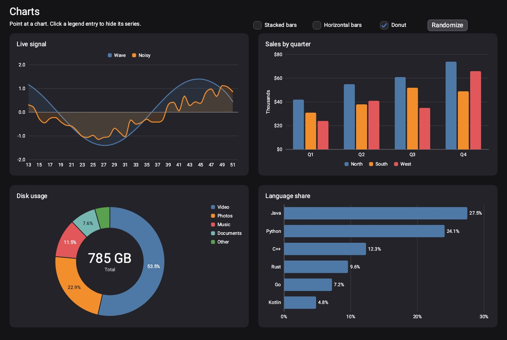

# Charts

[Documentation](../README.md) › Charts

> Needs the `rengl-charts` [module](../modules.md).

RenGL draws its own charts: lines, bars, pies and donuts, from plain numbers, with no other library. A chart is an
ordinary [`Overlay`](../core/overlay.md), so it goes in a layout or a container, sits in a
[`ScrollContainer`](../containers/scroll-container.md), follows the [theme](../styling/theming.md), and can be
[captured as an image](../core/snapshots.md) like any widget.



`me.piitex.examples.demo.ChartDemo` is a runnable dashboard with all of them: a live line chart that scrolls, bars that
stack and turn on their side, a donut, and a ranking.

| Chart | What it is for |
|---|---|
| [`LineChartOverlay`](line-chart.md) | Values that follow one another: a price over a year, the frame time of the last few seconds. Smooth curves, filled areas, gaps |
| [`BarChartOverlay`](bar-chart.md) | Amounts compared across categories: grouped, stacked, or on their side |
| [`PieChartOverlay`](pie-chart.md) | Shares of a whole. Give it a hole and it is a donut with the total in the middle |

They all live in `me.piitex.engine.ui.charts` and share the base class `ChartOverlay`.

```java
BarChartOverlay chart = new BarChartOverlay(640, 360); // width, height
chart.setTitle("Sales by region");
chart.setCategories("North", "South", "East", "West");
chart.addSeries("2025", 42, 31, 55, 28);
chart.addSeries("2026", 51, 36, 49, 40);
layout.addElement(chart);
```

## Data

The line and bar charts hold **categories** (the labels along one axis) and **series** (a named row of numbers, one
value for each category). A [`ChartSeries`](#chartseries) is drawn as a line, or as one bar in each group.

```java
chart.setCategories("Mon", "Tue", "Wed");  // or setCategories(List<String>)
ChartSeries web = chart.addSeries("Web", 120, 180, 150);
chart.addSeries("App", Color.GREEN, 80, 95, 140); // with a color of its own
chart.addSeries(new ChartSeries("API", 40, 60, 55).setColor(Color.ORANGE));

ChartSeries same = chart.getSeries("Web"); // by name or by index
chart.removeSeries(web);
chart.clearSeries();
```

A chart with more values than labels numbers the rest from 1, and one with no labels at all is numbered throughout.
`NaN` is a **gap**: a line breaks there and a bar is left out.

### ChartSeries

| Method | Description |
|---|---|
| `getName()` / `setName(String)` | The name in the legend and tooltip |
| `getColor()` / `setColor(Color)` | Its own color, or null (the default) for the next one of the palette |
| `isVisible()` / `setVisible(boolean)` | Draw it or not. A hidden series does not count toward the axis range either |
| `getValues()` / `setValues(double...)` | Every value at once |
| `get(int)` / `set(int, double)` / `size()` | One value; `set` past the end grows the series with gaps |
| `add(double)` | A value at the end |
| `removeFirst(int)` | Drops values from the start, for a chart that scrolls |

`ChartSeries` methods that change something return the series, so they chain.

## Live data

A chart reads its data every frame, so **a live chart is updated by changing the data and nothing else**. The new
numbers are not jumped to: the bars, lines and the axis ease there. A new value starts at the zero line (or the bottom of the plot)
and grows, which is also how a chart grows in when it first appears.

```java
// A chart that scrolls: a value arrives, the oldest leaves.
Scheduler.every(0.25f, () -> {
    chart.addCategory(timestamp());
    series.add(nextReading());
    chart.removeFirstCategories(1);
    series.removeFirst(1);
});

series.setValues(newNumbers);   // or replace them all: the chart eases from the old to the new
```

Changing a series from another thread is not safe. Callbacks and [`Scheduler`](../core/scheduler.md) timers run on the
render thread, and that is where to do it. If the work happens elsewhere, hand the result over with `Scheduler.runLater`.

```java
chart.setAnimated(false);       // jump straight to the data, no growing or easing
chart.setAnimationSpeed(12f);   // faster: the default 6 covers about 90% of the distance in 0.4 s
chart.finishAnimation();        // skip what is left, once. For tests and snapshots
```

## Interaction

- **Pointing** at a line or bar chart shows a tooltip with every series' value at that category, with a guide line (lines)
  or a highlighted band and bar (bars). Pointing at a pie lifts the slice and shows its share.
- **A legend entry** under the pointer holds the chart's attention on that series while the others fade back, and a
  **click** hides or shows it. The axis refits to what is left.
- **Clicking a point** (a left click) calls the listener set with `onPointClick`:

```java
chart.onPointClick(hit -> {
    // series index, category index, names and the value
    status.setText(hit.seriesName() + " in " + hit.categoryLabel() + ": " + hit.value());
});
```

`ChartHit` carries `series()`, `category()`, `seriesName()`, `categoryLabel()` and `value()`. A line chart reports the
point nearest the pointer in the category it is over; a bar chart the bar under it, and a click on empty space reports
nothing.

The tooltip is the chart's own, not the [`setTooltip`](../input/tooltips.md) bubble, because it follows the pointer
from point to point. It is drawn with the theme's tooltip colors. A chart is still free to have an ordinary tooltip of its own.

## Look

```java
chart.setTitle("Visitors");
chart.setLegendPosition(LegendPosition.TOP);   // NONE, TOP, BOTTOM (default), RIGHT (a pie's default)
chart.setPalette(Color.TEAL, Color.CORAL, Color.GOLD); // the colors series take in turn; repeats if short
chart.setPadding(20f);                          // from the edge to the drawing; default 14
chart.setFontSizes(18f, 13f);                   // title, everything else; default 16 and 12
chart.setTextColor(Color.WHITE);                // pins against theme switches
chart.setGridColor(Color.GRAY);

chart.getStyling().setBackgroundColor(panel);   // a chart is transparent by default
chart.getStyling().setCornerRadius(12f);
```

The default palette (`ChartOverlay.DEFAULT_PALETTE`) is ten colors chosen to stay apart from each other and to be readable
on light and dark backgrounds alike. `seriesColor(index)` says which one a series ends up with.

The chart is **transparent** until you give it a background through [`getStyling()`](../styling/styling.md): it takes its
text and grid colors from the [theme](../styling/theming.md) and follows a theme switch, except for what was set by hand
(`setTextColor`, `setGridColor`). `followTheme()` undoes that.

## Number formats

Axis labels, tooltips and data labels all write numbers with the chart's format. The default writes whole numbers as they are and
others to up to four decimals (`1,234`, `0.25`). `ChartFormat` has the usual others, and any `DoubleFunction<String>` will do:

```java
chart.setValueFormat(ChartFormat.currency("$")); // $1,200   -$40
chart.setValueFormat(ChartFormat.compact());     // 950  1.2K  3.4M  5B
chart.setValueFormat(ChartFormat.percent());     // 12.5%  (the value is already a percent)
chart.setValueFormat(ChartFormat.decimals(1));   // 3.0
chart.setValueFormat(ChartFormat.unit(" ms"));   // 12 ms
chart.setValueFormat(v -> String.format("%.1f kg", v)); // your own
```

Numbers always use a point and commas between thousands, so a chart reads the same on every machine. For another style,
pass your own function.

## Fonts

A chart makes two fonts when it is made, the title's and the label's. `setFontSizes` replaces them. When the chart is
thrown away for good, `dispose()` frees them, and the chart draws nothing after. It is a [`FontScalable`](../reference/custom-elements.md),
so a [`ResizableContainer`](../containers/resizable-container.md) scales its text.

## Testing and snapshots

Charts are drawn by the engine's `Renderer`, so a chart can be drawn by the `OffscreenRenderer` with no window. For a
picture that does not depend on timing:

```java nocompile
chart.setPosition(0, 0);
chart.finishAnimation();   // everything at rest
chart.hoverAt(300, 150);   // pretend the pointer is there (chart coordinates), until clearHover()
chart.finishAnimation();   // and the tooltip is fully in
```

`legendBounds(index)` says where a legend entry is.

## Limits

- Numbers only: a category axis of labels, and a value axis. There is no date or time axis, no log scale, no second value
  axis, and no scatter or bubble plot yet.
- A chart does not pan or zoom, and cannot select a range. Feed it the range to show.
- Category labels are never rotated. Ones that would overlap are skipped (every second, every third), so give a long list short labels or use a
  horizontal bar chart, which puts them down the side.
- The legend is one row, wrapping onto more rows when it is too wide, or one column. It cannot be moved freely.
- A chart updates as the data changes but does not copy it: a series is shared with whoever else holds it.
